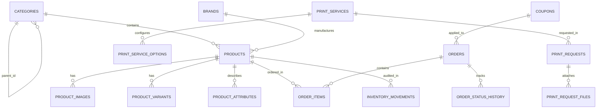

# Al Mostafa Mall — Database Architecture & Schema Specification

## 1. Overview & Database Engine

The production database schema for **Al Mostafa Mall (مول المصطفى)** is authored for **PostgreSQL 15+ (Supabase)**. It provides strict relational integrity, UUID primary keys, JSONB flexibility for dynamic attributes, automated timestamps via triggers, and Row Level Security (RLS) policies.

The full migrations are committed in:
- `supabase/migrations/20261009000000_al_mostafa_schema.sql` (Tables, enums, triggers, RLS)
- `supabase/migrations/20261009000001_seed_catalog.sql` (Comprehensive seed catalog across all 8 departments)

---

## 2. Entity Relationship Diagram (ERD)

---

## 3. Core Tables & Enums

### 3.1. Enums
- `department_key`: `home_cleaning`, `electronics`, `stationery`, `toys`, `bags`, `accessories`, `beauty`, `print_center`
- `order_status`: `pending_confirmation`, `confirmed`, `preparing`, `out_for_delivery`, `delivered`, `cancelled`, `returned`
- `payment_method`: `cash_on_delivery`, `instapay`, `vodafone_cash`, `card_on_delivery`
- `payment_status`: `pending`, `paid`, `failed`, `refunded`
- `print_pricing_model`: `per_page`, `per_unit`, `per_sqm`, `quote_only`
- `print_status`: `new`, `under_review`, `awaiting_files`, `awaiting_quote`, `quote_sent`, `approved`, `in_production`, `ready_for_pickup`, `completed`, `cancelled`
- `inventory_movement_type`: `restock`, `sale`, `adjustment`, `return`, `damaged`
- `user_role`: `super_admin`, `catalog_manager`, `order_manager`, `printing_staff`, `content_manager`, `customer`

### 3.2. Primary Relational Tables

| Table Name | Description | Key Indexes |
| :--- | :--- | :--- |
| `categories` | Hierarchical department and subcategory tree with icon and slug. | `slug` (UNIQUE), `department_key`, `parent_id` |
| `brands` | Official manufacturer brands (Samsung, HP, Dell, Dettol, Faber-Castell). | `slug` (UNIQUE), `is_featured` |
| `products` | Retail goods with EGP pricing, cost pricing, inventory, and SKU. | `sku` (UNIQUE), `slug` (UNIQUE), `category_id`, `brand_id` |
| `product_variants`| SKUs with variations in color, size, capacity, or pack. | `sku` (UNIQUE), `product_id` |
| `product_images` | High-resolution gallery images with primary flag and display ordering. | `product_id`, `is_primary` |
| `product_attributes`| Structured specifications (dimensions, country of origin, warranty). | `product_id`, `attribute_key` |
| `inventory_movements`| Immutable audit ledger of all stock additions, deductions, and sales. | `product_id`, `created_at` |
| `orders` | Customer purchases with Egyptian shipping address, phone, and totals. | `order_number` (UNIQUE), `customer_phone`, `order_status` |
| `order_items` | Snapshotted line items with unit price in EGP, SKU, and quantities. | `order_id`, `product_id` |
| `order_status_history`| Chronological audit log of order transitions with notes and staff actor. | `order_id`, `created_at` |
| `print_services` | Specialized industrial printing services (blueprints, business cards, etc.).| `slug` (UNIQUE), `is_active` |
| `print_service_options`| Parameter matrix (paper weight, laminate finish, binding wire/comb). | `service_id`, `option_key` |
| `print_requests` | Customer quotes and orders with specifications and file uploads. | `request_number` (UNIQUE), `status` |
| `coupons` | Promotional vouchers with percentage/fixed discount and minimum spend. | `code` (UNIQUE), `is_active` |
| `store_settings` | Dynamic operational parameters (shipping fees, WhatsApp, announcements). | `id` (PK) |
| `audit_logs` | Comprehensive security and administrative action ledger. | `created_at`, `entity_name` |

---

## 4. Row Level Security (RLS) Policies

All tables have RLS enabled by default:
- **Public / Anonymouse Read**: Active products, active categories, active brands, active banners, published CMS pages, and store settings are readable by all users.
- **Customer Self-Service**: Customers can read and create their own orders and print requests using their phone number or authenticated user ID.
- **Admin Full Access**: Authenticated users possessing staff roles (`super_admin`, `catalog_manager`, `order_manager`, `printing_staff`) are granted write permissions according to role checks.
