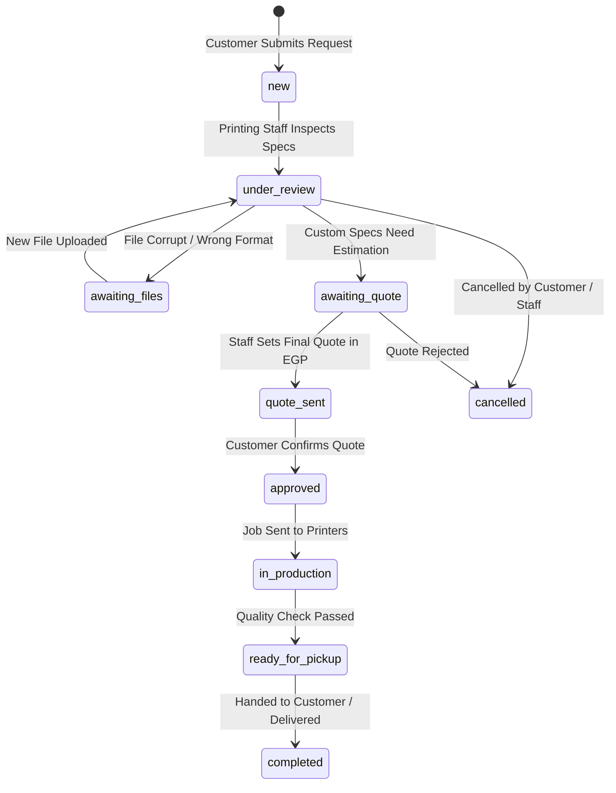

# Al Mostafa Mall — Specialized Printing Center Workflow & Architecture

## 1. Overview of the Dedicated Printing Center

The **Specialized Printing Center (مركز الطباعة المتخصص)** is a core department of **Al Mostafa Mall (مول المصطفى)**. Unlike standard e-commerce retail products with fixed stock units, printing jobs involve dynamic custom production parameters, multi-megabyte file attachments, variable paper media, binding finishes, and technical estimation.

---

## 2. Service Catalog Lines

| Service Line | Arabic Name | Pricing Model | Key Options | Turnaround |
| :--- | :--- | :--- | :--- | :--- |
| **Document & Thesis Printing** | طباعة المستندات والرسائل العلمية | `per_page` | Paper type (80g, 100g, 120g), Color mode (B&W vs Full Color), Binding (Thermal, Spiral, Hardcover Leather) | 12 Hours |
| **Engineering CAD & Blueprints**| اللوحات الهندسية والمخططات المعمارية | `per_page` | Size (A0, A1, A2, A3), Paper type (80g Bond, 110g Tracing Vellum), Folding (Cross-fold, Roll in Tube) | 6 Hours |
| **Roll-up Banners & Flex/Vinyl** | البانرات الإعلانية والرول أب | `per_sqm` | Material (Flex Banner 440g, Indoor Vinyl, Canvas Fabric), Finishing (Eyelets/Grommets, Roll-up Mechanism Stand) | 24 Hours |
| **Corporate Business Cards** | كروت العمل والمطبوعات التجارية | `per_unit` | Paper (Couche 350g, Kraft), Lamination (Matte, Glossy, Soft-touch), Spot UV, Rounded Corners | 48 Hours |
| **Hardcover Photo Albums** | ألبومات الصور والطباعة الفنية الفاخرة | `quote_only` | Album size (30x30cm, 20x30cm), Cover leather debossing, Metallic photo paper, Presentation box | 72 Hours |

---

## 3. Dynamic Calculation Engine

The calculator evaluates estimates in real-time on the client side:

### Formula A: Per-Page Model (Documents & Blueprints)
$$\text{Total Price} = \max\left(\text{Min Order}, \left[(\text{Base Page Price} + \sum \text{Option Impacts}) \times \text{Pages} \times \text{Copies}\right] + \text{Binding Fee}\right)$$

### Formula B: Per-Square-Meter Model (Banners & Signage)
$$\text{Area (SQM)} = \frac{\text{Width (cm)} \times \text{Height (cm)}}{10,000}$$
$$\text{Total Price} = \max\left(\text{Min Order}, \left[(\text{Base SQM Price} + \sum \text{Finishing Impacts}) \times \text{Area} \times \text{Quantity}\right]\right)$$

### Formula C: Quote-Only Model
- Generates immediate quotation submission request without charging customer upfront.
- Customer receives tracking number (e.g. `PRNT-549102`) and direct WhatsApp notification link.

---

## 4. Lifecycle State Machine

---

## 5. File Handling & Staff Review

1. **File Upload Interface**: Supports PDF, Adobe Illustrator (.ai), Photoshop (.psd), Microsoft Word (.docx), and compressed archives (.zip) up to 100MB.
2. **Staff Inspection (`/admin/printing/requests/:id`)**:
   - Technical specifications inspection (dimensions, color mode, paper stock, binding).
   - Instant file preview and download link.
   - Quotation override or final quote entry in EGP (`final_quote_egp`).
   - Internal technical notes field for press technicians.
   - One-click WhatsApp message generation with pre-filled status and price details.
